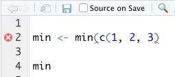
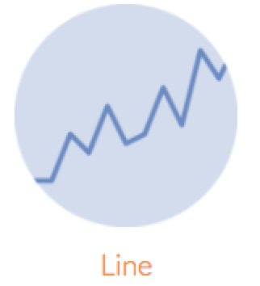
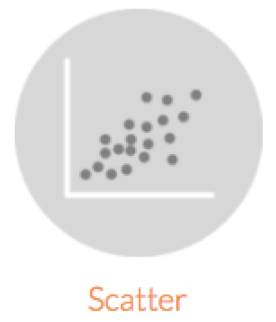

```{css, echo=FALSE}
.small { font-size: 90% }
.smaller { font-size: 80% }
```

```{r setup, include=FALSE}
library(tidyverse)
library(knitr)
library(countdown)
library(kableExtra)
library(formatR)
library(scales)
library(ggthemes)
options(scipen=999)

opts_chunk$set(warning=FALSE, message=FALSE)

extra_css <- list(
  ".small" = list("font-size" = "90%"),
  ".smaller" = list("font-size" = "80%")
  )

xaringanthemer::style_extra_css(css = extra_css, outfile = "custom.css")

wacky_palette <- c("#FF0099", "#00CCFF", "#FF9900", "#33FF33", "#FF33CC", "#FFFF66", "#6600CC")

airbnb <- read_csv('https://bit.ly/3oadz2L', col_types = cols())
climate <- read_csv('https://bit.ly/3kKErEb', col_types = cols())
mba <- read_csv("https://bit.ly/4evYpeW", col_types = cols())
```

# Housekeeping

- Reminder: Submit a memo created in R by October 30 or before
  - The memo must include (a) two data visualizations or (b) one data visualization and one table
  - The memo's text can be placeholder text (e.g., "lorem ipsum")
  - Start from a [memo template](https://github.com/gbearden/r_course_evans_school/tree/master/memo_templates) and see the [example memo](https://gbearden.github.io/r_course_evans_school/memo_templates/memo_pdf.pdf)
  - See example plots [here](https://github.com/gbearden/r_course_evans_school/tree/master/plots) on GitHub
- What does "stakeholder-ready" mean?
  - Write a plot title
  - Label the axes 
  - Use a theme
  - Do not include `NA`s in the plot (geom or legend)


---

# Housekeeping

- Stay in touch! 
  - Feel free to connect with me on LinkedIn
  - Discussing data science/analytics careers
- Datasets for your memo
  - [Kaggle](https://www.kaggle.com/datasets)
  - [Data.gov](https://www.data.gov/)
  - [Google Dataset Search](https://datasetsearch.research.google.com/)
  - [Awesome Public Datasets on GitHub](https://github.com/awesomedata/awesome-public-datasets)
  - [Our World in Data](https://ourworldindata.org/)
  - Local open data: [Seattle](https://data.seattle.gov/), [King County](https://data.kingcounty.gov/), and [Washington State](https://data.wa.gov/)
  - [Pew Research Center](https://www.pewresearch.org/datasets/) and [ProPublica Data Store](https://www.propublica.org/datastore/)
  - BONUS: [TidyTuesday](https://github.com/rfordatascience/tidytuesday), a new dataset every week

**Data for class**  
```r
airbnb <- read_csv('https://bit.ly/3oadz2L')
climate <- read_csv('https://bit.ly/3kKErEb')
mba <- read_csv("https://bit.ly/4evYpeW")
```

---

# What we learned in the previous class

- Overview of ggplot2
- Building bar plots
  - Aggregated data (`stat = "identity"`)
  - Disaggregated data (`stat = "count"`)
  - Stacked and dodged bars
- Customizing plots
  - Adding themes, titles, scales, and color palettes to plots
- Building line and scatter plots

---

# What we'll learn today

- Creating population pyramids
- Practicing scatter and line plots
- Creating multi-geom (line and bar) plots
- Reshaping data with `pivot_longer()` and `pivot_wider()`
- Working directories and R Projects
- Creating a memo in R with R Markdown

---

# A few reminders

- Run code line by line  
- Ensure the code finished running (`+`s vs. `>`s in the R console)  
- Red "x" annotation beside line numbers (after saving your file)



---

# A few reminders

```r
# stat = "count"
airbnb %>% 
  ggplot(
    aes(
      x = address,
      fill = address
      )
    ) + 
  geom_bar()
  
# stat = "identity"
airbnb %>% 
  group_by(address) %>% 
  summarise(count = n()) %>%
  ggplot(
    aes(
      x = address,
      y = count,
      fill = address
      )
    ) + 
  geom_bar(stat = 'identity')
```

---

# Warm-up Exercise - MBA admissions

Create a stacked bar plot from the UPenn MBA admissions data that shows the number of non-international students by work industry. 

- Stacked bar segments should be mapped to a new variable that indicates whether a GMAT score is high or low. You can decide the threshold for what's "high" and "low"
- Use `reorder()` to sort the bars. Remember that when sorting (or reordering) bars you need to aggregate the data with `group_by()` and `summarise()` before creating the plot  
- Don't forget to use `filter()` to exclude international students 
- Update plot and axis titles and use a theme if you have time

```r
mba <- read_csv("https://bit.ly/4evYpeW")
```

--

```r
mba %>%
  filter() %>% # remove international students from the tibble
  mutate() %>% # create a new variable indicating whether the GMAT score is high/low
  group_by() %>% # group on character variables mapped to an axis and fill
  summarise() %>% # count applications
  ggplot() + 
  geom_bar()
```

```{r, echo = FALSE}
countdown(minutes = 7, seconds = 0)
```

---

# Warm-up Exercise - MBA admissions

Create a stacked bar plot from the UPenn MBA admissions data that shows the number of non-international students by work industry. 

```{r, dpi = 300, fig.height = 3, fig.width = 5, echo = FALSE, warning=FALSE, message=FALSE}
mba %>%
  filter(international == FALSE) %>% 
  mutate(high_gmat = if_else(gmat > 650, "High GMAT Score", "Low GMAT Score")) %>% 
  group_by(work_industry, high_gmat) %>% 
  summarise(n = n()) %>% 
  ggplot(aes(y = reorder(work_industry, n), x = n, fill = high_gmat)) +
  geom_bar(stat = "identity") + 
  labs(fill = NULL) + 
  theme_fivethirtyeight() + 
  scale_fill_fivethirtyeight()
```

---

# Warm-up Exercise - MBA admissions

Create a stacked bar plot from the UPenn MBA admissions data that shows the number of non-international students by work industry. 

```r
mba %>%
  filter(international == FALSE) %>% 
  mutate(high_gmat = if_else(gmat > 650, "High GMAT Score", "Low GMAT Score")) %>% 
  group_by(work_industry, high_gmat) %>% 
  summarise(n = n())  
```

---

# Warm-up Exercise - MBA admissions

Create a stacked bar plot from the UPenn MBA admissions data that shows the number of non-international students by work industry. 

```r
mba %>%
  filter(international == FALSE) %>% 
  mutate(high_gmat = if_else(gmat > 650, "High GMAT Score", "Low GMAT Score")) %>% 
  group_by(work_industry, high_gmat) %>% 
  summarise(n = n()) %>% 
  ggplot(aes(y = reorder(work_industry, n), x = n, fill = high_gmat)) +
  geom_bar(stat = "identity") + 
  labs(fill = NULL) + 
  theme_fivethirtyeight() + 
  scale_fill_fivethirtyeight()
```

--

How do you turn this plot into a population pyramid style plot?

---

class: small

# Warm-up Exercise - MBA admissions

```{r, fig.show='hide'}

  mba %>%
    filter(international == FALSE) %>% 
    mutate(high_gmat = if_else(gmat > 650, "High GMAT Score", "Low GMAT Score")) %>% 
    group_by(work_industry, high_gmat) %>% 
    summarise(n = n()) %>% 
    mutate(   #<<
      industry_n = sum(n),   #<<
      n = if_else(high_gmat == "Low GMAT Score", n * -1, n)   #<<
      ) %>%    #<<
    ggplot(
      aes(
        y = reorder(work_industry, -industry_n),    #<<
        x = n, 
        fill = high_gmat
        )
      ) +
    geom_bar(stat = "identity") + 
    scale_x_continuous(   #<<
      labels = function(x) abs(x),   #<<
      limits = function(x) c(-max(abs(x)), max(abs(x)))   #<<
      ) +   #<<
    labs(fill = NULL) + 
    theme_fivethirtyeight() + 
    scale_fill_fivethirtyeight()
```

---
class: inverse, middle, center

# Recapping scatterplots and line plots

---

# Recapping scatterplots and line plots

.pull-left[


Line plot: 1 continuous variable + ordinal variable   

- Well suited to dates and other ordered variables
- Use `color` and `linetype` to style lines

```r
climate %>% 
  group_by(year) %>%
  summarise(
    unc = mean(
      uncertainty, na.rm = TRUE
      )
    ) %>% 
  ggplot(aes(x = year, y = unc)) +
  geom_line()
```
]

.pull-right[


Scatterplot: 2 continuous variables 

- When many points overlap, `alpha` is useful
- Use `color`, `shape`, and `size` to style points

```r
climate %>% 
  ggplot(
    aes(x = temp, y = uncertainty)
    ) + 
  geom_point(alpha = .1)
```
]

---

# Exercise

- With `climate`, create a line plot of mean Fahrenheit temperatures for cities in Brazil
  - Data should be for 1850 and onward ([help](https://gbearden.github.io/r_course_evans_school/slides/part_2/#32))  
  - Use the following formula to convert Celsius to Fahrenheit: `(temp * 9/5) + 32` ([help](https://gbearden.github.io/r_course_evans_school/slides/part_2/#14))  
  - Create the mean temperature with `summarise` and call it `mean_temp` ([help](https://gbearden.github.io/r_course_evans_school/slides/part_2/#39))  
  - Make line color equal to `city`
  - Feel free to change plot aesthetics as you see fit (add a theme; change axis, legend, or plot titles; change the color of lines for cities; etc.)  
  - *Click forward once for a hint on the functions required to prepare the data*  
  - *Click forward twice to see the plot you'll create*

```{r, echo = FALSE}
countdown(minutes = 15, seconds = 0, left = 0)
```

--

```r
climate %>% 
  filter() %>% 
  mutate() %>% 
  group_by() %>% 
  summarise()
```

---

# Exercise

```{r, dpi = 300, fig.height = 4, fig.width = 6, echo = FALSE, warning=FALSE, message=FALSE}
climate %>% 
  filter(country == 'Brazil' & year >= 1850) %>% 
  mutate(temp = (temp * 9/5) + 32) %>% 
  group_by(year, city) %>% 
  summarise(mean_temp = mean(temp, na.rm = TRUE)) %>% 
  ggplot(aes(x = year, y = mean_temp, color = city)) + 
  geom_line(linewidth = 1) + 
  theme_bw() + 
  scale_color_wsj() + 
  labs(
    x = 'Year'
    , y = 'Mean Temperature'
    , title = 'Temperatures in 6 Brazilian Cities, 1850 - present'
    , color = NULL
  )
```

---

# Exercise

```r
climate %>% 
  filter(country == 'Brazil' & year >= 1850) %>% 
  mutate(temp = (temp * 9/5) + 32) %>% 
  group_by(year, city) %>% 
  summarise(mean_temp = mean(temp, na.rm = TRUE)) %>% 
  ggplot(aes(x = year, y = mean_temp, color = city)) + 
  geom_line(linewidth = 1) + 
  theme_bw() + 
  scale_color_wsj() + 
  labs(
    x = 'Year'
    , y = 'Mean Temperature'
    , title = 'Temperatures in 6 Brazilian Cities, 1850 - present'
    , color = NULL
  )
```

---
class: inverse, middle, center

# Reshaping a tibble or data frame

---

# Reshaping

- `pivot_longer()` and `pivot_wider()` are the functions we use to reshape data
- Reshaping means turning...
  - Columns into rows (with `pivot_longer()`), so the new tibble is narrower and has more rows than the old tibble
  - Rows into columns (with `pivot_wider()`), so the new tibble is wider and has fewer rows than the old tibble
  


---

# Reshaping

- `pivot_longer()` and `pivot_wider()` are the functions we use to reshape data
- Reshaping means turning...
  - Columns into rows (with `pivot_longer()`), so the new tibble is narrower and has more rows than the old tibble
  - Rows into columns (with `pivot_wider()`), so the new tibble is wider and has fewer rows than the old tibble
  


---

# Reshaping

`pivot_longer()`
- Turn columns into rows
- Data are often **easier to analyze** in a longer format
- 4 arguments
  - `data`, your tibble 
  - `cols`, which columns you want to turn into rows
  - `names_to`, name of the new column that holds the old column names
  - `values_to`, name of the new column that holds the values
  
```r
airbnb %>% 
  select(room_id, host_id, room_type, address, reviews, rating) %>% 
  pivot_longer(
    cols = c(reviews, rating),
    names_to = 'rental_characteristics',
    values_to = 'values'
    )
```

---

# Reshaping

`pivot_wider()`
- Turn rows into columns
  - Good use of screen space
  - Data may be **easier to read** when denormalized (in a wider format)
  - Useful for reporting and for setting up calculations in specific situations
- 3 arguments
  - `data`, your tibble  
  - `names_from`, name of the column that contains the names of the new columns
  - `values_from`, name of the column that contains the values of the new columns

```r
airbnb %>% 
  group_by(address, room_type) %>% 
  summarise(number_of_rentals = n()) %>% 
  pivot_wider(names_from = room_type, values_from = number_of_rentals)
```

--

```r
airbnb %>% 
  group_by(address, room_type) %>% 
  summarise(number_of_rentals = n()) %>% 
  pivot_wider(names_from = room_type, values_from = number_of_rentals) %>% 
  mutate(private_or_shared = `Private room` + `Shared room`)
```

---

# Exercise - 10 minutes

With the `climate` data, report the mean temperatures for `"Angola"`, `"Ivory Coast"`, `"Ethiopia"`, and `"Kenya"` in the years `1850`, `1900`, `1950`, and `2000`.
- There should be one row per country
- Pivot the data so the years are columns (see the hint on the next slide)
- In this exercise, you will use `filter()`, `group_by()`, `summarise()`, and `pivot_wider()`

```{r, echo = FALSE}
countdown(minutes = 10, seconds = 0)
```

---

# Exercise - 10 minutes

**Hint:** your output should have this shape
```{r, echo = FALSE, warning=FALSE, message=FALSE}
climate %>% 
  filter(
    country %in% c('Angola', 'Ivory Coast', 'Ethiopia', 'Kenya') 
    & year %in% c(1850, 1900, 1950, 2000)
  ) %>% 
  group_by(country, year) %>% 
  summarise(temp = mean(temp, na.rm = TRUE)) %>% 
  pivot_wider(names_from = year, values_from = temp) %>% 
  mutate(across(.cols = ! contains('country'), ~ case_when(is.numeric(.x) ~ '-'))) %>% 
  as.data.frame()
```

---

# Exercise - 10 minutes

```r
climate %>% 
  filter(
    country %in% c('Angola', 'Ivory Coast', 'Ethiopia', 'Kenya') 
    & year %in% c(1850, 1900, 1950, 2000)
  ) %>% 
  group_by(country, year) %>% 
  summarise(temp = mean(temp, na.rm = TRUE)) %>% 
  pivot_wider(names_from = year, values_from = temp)
```

---
class: inverse, middle, center

# Creating a memo in R

---

# Why create memos in R?

- Your code, plots, tables, and text live in one file
- When the data change, click **Knit** and the whole memo updates
  - No copying and pasting plots into Word
- Numbers in your text can come straight from your data

--

**R Markdown**

- An R Markdown file (`.Rmd`) combines plain text with chunks of R code
- When you click **Knit**, R runs every chunk from top to bottom and creates a document (PDF or HTML) with your text and the code's output
- The memo templates for the assignment are R Markdown files
  - `memo_pdf.Rmd` creates a PDF memo (preferred)
  - `memo_html.Rmd` creates an HTML memo (backup if you can't create a PDF)

---

class: small

# Set up the memo templates

1. [Download all of the memo templates](https://github.com/gbearden/r_course_evans_school/raw/master/memo_templates.zip) as a zip file
2. **Unzip** the folder and move it somewhere you can find it (e.g., Documents)
  - On Windows, right-click the zip file and select **Extract All**. Don't open files from inside the zip file
  - Keep the files together in one folder. The memos need the other files in the folder to knit
3. Install the packages the memo needs (run this in the console, not in the memo)

    ```r
    install.packages(c("rmarkdown", "knitr", "tinytex"))
    ```

4. Install TinyTeX, a small version of LaTeX that R uses to create PDFs (run this in the console)

    ```r
    tinytex::install_tinytex()
    ```

    - The download takes a few minutes. When it finishes, restart RStudio (**Session > Restart R** isn't enough; quit and reopen RStudio)
    - Check the install: `tinytex::is_tinytex()` should return `TRUE`
    - Already have LaTeX (e.g., MiKTeX or MacTeX)? Skip this step
    - On a Mac, you may be asked for your password. On Windows, the install can fail if your user name has spaces or accents
    - If TinyTeX won't install, use `memo_html.Rmd` to create an HTML memo instead
    
---

# Use R Projects to create a memo

An **R Project** sets the working directory to a folder every time you open the project

The memo templates folder includes an R Project file, `memo_templates.Rproj`

1. In the unzipped `memo_templates` folder, double-click `memo_templates.Rproj` (or in RStudio, select **File > Open Project...**)
2. RStudio opens the project. The project name appears in the top-right corner
3. Run `getwd()` in the console. It should print the path to `memo_templates`

--

**Tips**

- Open the project the same way every time you work on your memo
- Open files from the **Files** pane (bottom right), which starts in the project folder
- To make a project for another folder, select **File > New Project... > Existing Directory**
- No R Project? Use **Session > Set Working Directory > To Source File Location**
- Don't put `setwd()` in your memo. The path only works on your computer

---

# Knit the template

- Open `memo_templates.Rproj` in the `memo_templates` folder
- Open `memo_pdf.Rmd` from the **Files** pane
- Click **Knit** at the top of the script pane
- RStudio creates `memo_pdf.pdf` in the same folder and opens a preview
  - The first PDF knit is slow because TinyTeX downloads the LaTeX packages the memo needs
  - Can't create a PDF? Open `memo_html.Rmd` and knit it instead
- Don't change anything yet! First, make sure the template knits on your computer

<br>

**Did it work?** If you see an error, raise your hand. Check `getwd()` first, then see the common knitting errors later in the deck.

---

# Anatomy of an R Markdown file

.pull-left[
**1. YAML header**   
Settings between the `---` lines at the top. `params` fill in the memo's header

```yaml
params:
  to: "Councilmember, Seattle..."
  from: "Your Name, Office of..."
  date: !r format(Sys.Date(), ...)
  re: "Short-term rental listings"
```

**2. Text**   
Plain text, formatted with Markdown

```md
## Background

Text in **bold** and *italics*
```
]

.pull-right[
**3. Code chunks**   
R code between ```` ``` ```` fences. The output (a plot, a table) appears in the memo

````md
`r ''````{r listings-plot, echo = FALSE}
airbnb %>%
  ggplot(aes(x = address)) +
  geom_bar()
```
````

**4. Inline code**   
R code inside a sentence, such as `r knitr::inline_expr("comma(n_listings)")`, is replaced with its result (`r comma(nrow(airbnb))`) when you knit
]

---

class: small

# Code chunks

- The first line names the chunk and sets **chunk options**

````md
`r ''````{r listings-plot, echo = FALSE, fig.width = 4, fig.height = 2.8}
````

- Useful chunk options for plots in the memo templates
  - `fig.width`, `fig.height`: the plot's shape (in inches)
  - `wrap = "right"` or `wrap = "left"`: wrap the text that follows around the plot
  - `wrap.width = 0.45`: share of the page width the plot takes up
- **`echo` vs. `include`**: both run the code. They differ in what shows up in the memo

| Option | Shows the code? | Shows the output? | Use it for |
|---|---|---|---|
| `echo = FALSE` | No | Yes | Chunks that add the header, a plot, or a table |
| `include = FALSE` | No | No | Chunks that only prepare data (`setup`, `data`) |

- To show a chunk's code, use `echo = TRUE`

--

**Run code as you write it**

- Click the green arrow in a chunk's top-right corner to run the chunk
- Or run code line by line as usual with **Cmd/Ctrl + Enter**
- Run chunks before you knit to catch errors early

---

# Updating the memo header

Edit the `params` in the YAML header

```yaml
params:
  to: "Director, Seattle Office of Housing"
  from: "Your Name"
  date: !r format(Sys.Date(), "%B %d, %Y")
  re: "Airbnb prices in the Seattle area"
```

- Keep the quotation marks
- Keep the indentation (two spaces before each field)
- Leave `date` as is. It fills in today's date when you knit

---

class: small

# Exercise: Updating the memo plot

Replace the plot in your memo with the Brazil line plot you made earlier today

- Load the data your plot uses in the `data` chunk: `climate <- read_csv("https://bit.ly/3kKErEb")`
- Find the chunk named `listings-plot` and replace its code with your Brazil line plot code
- The plot uses `scale_color_wsj()`, so add `library(ggthemes)` to the `setup` chunk
- Knit the memo. If the plot title is cut off, shorten it or increase `fig.width`
- Later, swap in your own stakeholder-ready plot: a plot title, axis labels, a theme, and no `NA`s

```{r, echo = FALSE}
countdown(minutes = 3, seconds = 0)
```

--

```r
climate %>% 
  filter(country == 'Brazil' & year >= 1850) %>% 
  mutate(temp = (temp * 9/5) + 32) %>% 
  group_by(year, city) %>% 
  summarise(mean_temp = mean(temp, na.rm = TRUE)) %>% 
  ggplot(aes(x = year, y = mean_temp, color = city)) + 
  geom_line(linewidth = 1) + 
  theme_bw() + 
  scale_color_wsj() + 
  labs(x = 'Year', y = 'Mean Temperature', color = NULL,
       title = 'Temperatures in 6 Brazilian Cities, 1850 - present')
```

---

class: small

# Exercise: Updating the memo table

Replace the table in your memo with the climate table you made in the reshaping exercise

- Make sure `climate` is loaded in the `data` chunk
- Find the chunk named `price-table` and replace its code with your reshaping code
- End your code with `kable()`, which formats a tibble as a table. Use `digits = 1` to round the temperatures
- Knit the memo
- Later, swap in your own table made with `group_by()` and `summarise()`

```{r, echo = FALSE}
countdown(minutes = 3, seconds = 0)
```

--

```r
climate %>% 
  filter(
    country %in% c('Angola', 'Ivory Coast', 'Ethiopia', 'Kenya') 
    & year %in% c(1850, 1900, 1950, 2000)
  ) %>% 
  group_by(country, year) %>% 
  summarise(temp = mean(temp, na.rm = TRUE)) %>% 
  pivot_wider(names_from = year, values_from = temp, names_sort = TRUE) %>% 
  kable(digits = 1, caption = 'Mean temperature (Celsius) by country and year')
```

---

class: small

# Common knitting errors

| Error message | What to do |
|---|---|
| `cannot open file 'memo_setup.R'` | Unzip the templates, keep all of the files in the same folder as your `.Rmd`, and open the R Project. Check `getwd()` |
| `object 'my_data' not found` | Knitting starts with an empty environment. Load your data and create every object **in the memo**, above the chunk that uses it |
| `there is no package called 'scales'` | Install the package in the console with `install.packages("scales")` |
| `could not find function "theme_wsj"` | Add the library (e.g., `library(ggthemes)`) to the `setup` chunk |
| `'my_file.csv' does not exist` | Use a URL, or save the CSV in the memo's folder (your project folder) and use `read_csv("my_file.csv")` |
| `LaTeX failed to compile` or `No LaTeX installation detected` | Install TinyTeX (see the setup slide) and restart RStudio. Still stuck? Use `memo_html.Rmd` |
| `Error in ...` with a chunk name | The error message names the chunk that failed. Run that chunk on its own to find the problem |

<br>

**Tip:** Knit often. It's easier to find an error after a small change than after many changes

---

# Wrapping up

**Assignment**

- Submit your memo by October 30 or before
- See the [memo templates](https://github.com/gbearden/r_course_evans_school/tree/master/memo_templates), the [example memo](https://gbearden.github.io/r_course_evans_school/memo_templates/memo_pdf.pdf), and the [example plots](https://github.com/gbearden/r_course_evans_school/tree/master/plots)

**Next steps**

- [R for Data Science (2e)](https://r4ds.hadley.nz/), the best next step after this course
- [Cheat sheets](https://posit.co/resources/cheatsheets/) for data transformation, data tidying, data visualization, and R Markdown
- Practice with a dataset you care about (see the dataset links in today's housekeeping slides)

**Stay in touch!**

- Feel free to connect with me on LinkedIn

---
class: inverse, middle, center

# Bonus exercise (if time allows)

---

# Bonus exercise: scatterplots

- With `airbnb`, create a scatterplot that plots two numeric variables  
- In addition to `x` and `y`, include another argument in `aes()`
   - For example, `size`, `shape`, `color` or `alpha`  
- Use `group_by()` and `summarise()` if you would like  
- Feel free to subset your data with `filter()` or `sample_n()`

```{r, echo = FALSE}
countdown(minutes = 7, seconds = 0, left = 0)
```

---

# Bonus exercise: scatterplots

```{r, dpi = 300, fig.height = 4, fig.width = 7, echo = FALSE, warning=FALSE, message=FALSE}
airbnb %>% 
  ggplot(aes(x = longitude, y = latitude, color = address)) + 
  geom_point(alpha = .6) + 
  theme_bw() + 
  labs(
    x = 'Longitude'
    , y = 'Latitude'
    , color = 'City'
    , title = 'Coordinates of Seattle-area Airbnbs'
  )
```

---

# Bonus exercise: scatterplots

```r
airbnb %>% 
  ggplot(aes(x = longitude, y = latitude, color = address)) + 
  geom_point(alpha = .6) + 
  theme_bw() + 
  labs(
    x = 'Longitude'
    , y = 'Latitude'
    , color = 'City'
    , title = 'Coordinates of Seattle-area Airbnbs'
  )
```
